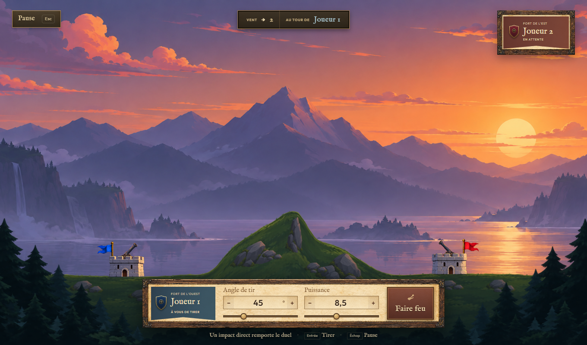

# Artillery

Un duel d’artillerie dans une vallée au coucher du soleil. Réglez votre angle et votre puissance, composez avec le vent et détruisez le fort adverse.

**[Télécharger Artillery pour Windows](https://github.com/Azukkia/artillery-pc/releases/latest)**

Choisissez le fichier **Artillery-Setup-X.Y.Z.exe** de la dernière version, lancez-le, puis ouvrez Artillery depuis le Bureau ou le menu Démarrer. Windows 10/11, 64 bits. Le jeu fonctionne hors ligne.

## Trois façons de jouer

- **Contre l’IA** : défendez le fort bleu face à un adversaire hors ligne. Difficultés Apprenti, Artilleur et Maître.
- **Duel sur ce PC** : deux joueurs partagent le clavier et tirent à tour de rôle.
- **Duel en réseau local** : deux PC sur le même réseau ; invitez l’autre joueur depuis le salon.

Les forts, les canons et les boulets ont des collisions physiques ; les impacts creusent le terrain. Les traces suivent la couleur du camp qui tire. Réglez la visée avec les curseurs ou les valeurs numériques. Échap ouvre la pause en solo ou à deux sur le même PC.

## Mises à jour

Après cette première installation, Artillery vérifie les nouvelles versions au démarrage. Acceptez le téléchargement, puis choisissez **Installer et redémarrer** au menu. **Plus tard** permet de continuer à jouer. Une partie en cours n’est pas interrompue et vos réglages sont conservés.

Les anciens dossiers portables doivent utiliser une fois le nouvel installateur pour bénéficier des mises à jour. L’exécutable ne possède pas encore de certificat de signature ; Windows peut demander une confirmation au premier lancement.

Ce dépôt sert à distribuer les installateurs et les mises à jour. Le code source du projet n’y est pas publié.
